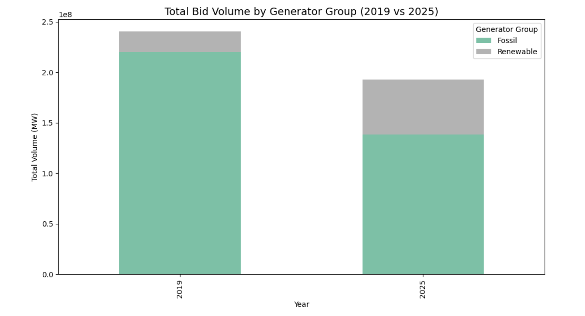

# NEM Emissions & Bidding Analysis

## Overview

A Python-based analysis of emissions intensity and generator bidding behaviour in the Australian National Electricity Market (NEM).

Using emissions data from April 2019 to April 2025 and generator bid data for April 2019 and April 2025 (the 2025 bid file is about 1.6 million rows), the project examines how Australia's electricity market evolved between 2019 and 2025, focusing on regional decarbonisation trends, fossil-fuel bidding behaviour, and differences in market structure across NEM regions.

This analysis was completed as part of a Macquarie University capstone project and received a Distinction.

**Key Result:** NSW reduced carbon intensity by 21.7% between 2019 and 2025, while fossil fuel generator bid-price volatility increased substantially, with the interquartile range widening from $85/MWh in 2019 to $210/MWh in 2025.

## Analytical Questions

1. How did carbon intensity change across NEM regions between 2019 and 2025?
2. How did fossil fuel generator bid prices differ between 2019 and 2025?
3. What regional and intra-daily emissions patterns were visible in the data?

## Key Findings

**NSW showed the strongest carbon intensity improvement**  
NSW achieved a 21.7% reduction in carbon intensity between 2019 and 2025, compared with a national average decline of 7.7%.

**Fossil generator bidding was more volatile in April 2025 than in April 2019**  
Comparing April 2019 with April 2025, the fossil bid price interquartile range widened from $85/MWh in 2019 to $210/MWh in 2025. This is a two-point comparison, not a continuous trend. The report's supply curve comparison reads this as fossil generators shifting from baseload providers toward more strategic peak-pricing behaviour, which is an interpretation of the curve shapes, not a measurement of why generators bid as they did.

**Regional emissions patterns varied significantly**  
Time series and intra-daily trend charts showed clear differences in emissions profiles across NEM regions, highlighting the importance of region-level analysis.

## Project Preview

### Regional Emissions Comparison

## Data & Methodology

### Data Sources
- CSIRO NEM Emissions API
- NEM generator bid-stack files for April 2019 and April 2025
- Five NEM regions: NSW, VIC, QLD, SA and TAS

### Dataset Size
- 2025 bid file of about 1.6 million rows (over 16 million after reshaping to long format)
- Emissions data at five-minute intervals, April 2019 to April 2025 (73 months), aggregated to monthly averages
- Generator bidding and emissions records analysed across regions and technologies

## Skills Demonstrated

- Data collection and preparation
- Python data cleaning and transformation
- Time series analysis using 5-minute interval market data
- Regional comparison and trend analysis
- Market behaviour and bidding analysis
- Matplotlib data visualisation
- Translating technical findings into business insights

## Contribution Note

This was a group capstone project completed at Macquarie University. I did the Python for the bidding analysis and the data cleaning. The Python code included in the linked repository is the cleaned, shareable version of the project code. The report PDF is an excerpt of the collaborative group report with the cover page removed. Full group authorship is acknowledged.

## Source Code & Files

<a href="https://github.com/VivekDhanwada/data-analytics-portfolio/tree/main/01-nem-emissions-bidding" target="_blank" rel="noopener noreferrer">View full project files on GitHub →</a>
